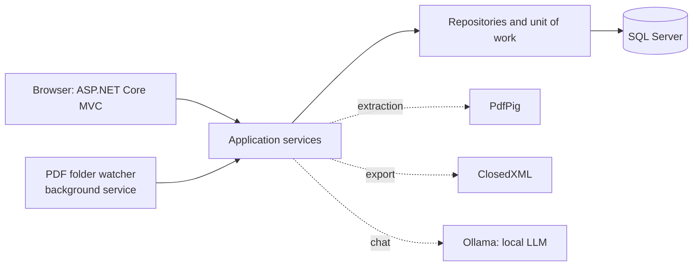

# Dataman

**A pre-sales and quotation management web app: it reads quotation PDFs automatically, tracks prospects through a sales pipeline, and includes a local AI assistant. Built on ASP.NET Core 10 and SQL Server.**

> The source code for this project is private. This repository is a public showcase of what it does and how it is built. Want a demo or a walkthrough? Reach me via [ramizpa.com](https://ramizpa.com).

## What it does

Pre-sales teams spend hours re-typing quotation PDFs into trackers and chasing prospects across spreadsheets. Dataman does the typing for them and keeps the whole pre-sales picture in one place:

1. **Quotations in:** drop a quotation PDF into the app, or into a watched folder, and Dataman extracts the quotation fields into the database.
2. **Prospects tracked:** every prospect has a status, activity history, flags and a place in the sales pipeline.
3. **Pre-sales work recorded:** proof-of-concept records, demo schedules, site surveys and bills of materials sit next to the quotation they belong to.
4. **Insight on demand:** dashboards, analytics and a year-end review show where the pipeline stands, and a local AI chat answers questions without sending data outside.

## Features

**Quotations**
- Upload quotation PDFs or let a background folder watcher pick them up
- Automatic field extraction from the standard quotation format
- Processing log showing what was imported, skipped or failed
- Quotation list with filters and status tracking, with Excel export

**Prospects and pipeline**
- Prospect records with status, activity timeline and flags
- Visual pipeline view and prospect analysis
- Financial-year tracking and a year-end review

**Pre-sales**
- Proof-of-concept (POC) tracking with status
- Demo scheduling, site surveys and bill-of-materials items

**Dashboard and analytics**
- KPI dashboard and analytics pages built from live data

**AI assistant**
- Chat assistant powered by a locally hosted model (Ollama), so data stays on your own server
- Animated assistant face in the interface

**Administration**
- Role-based access (Admin and User), user management and profile photos
- Configurable application settings

## Architecture

The app follows a layered structure: domain entities and interfaces, application services and DTOs, and an infrastructure layer for EF Core data access, repositories and the background watcher.

## Tech stack

| Layer | Technology |
|---|---|
| Backend | C#, ASP.NET Core 10 MVC, Entity Framework Core 10 |
| Database | SQL Server with EF Core migrations |
| Auth | ASP.NET Core Identity with roles |
| PDF reading | PdfPig |
| Excel export | ClosedXML |
| AI | Ollama (local large language model) |
| Background work | ASP.NET Core hosted service (folder watcher) |

## Screenshots

*Screenshots coming soon.*

## Version history

See the [changelog](./CHANGELOG.md) for dated releases and what changed in each.

## Author

Built by [Ramiz P A](https://github.com/ramizpa). More projects at [ramizpa.com](https://ramizpa.com).
